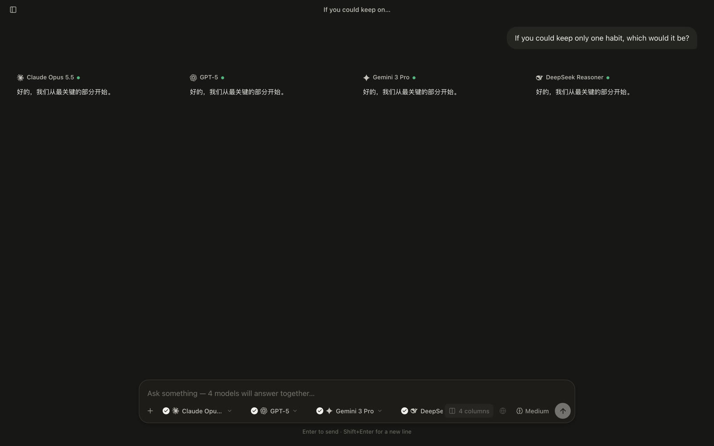
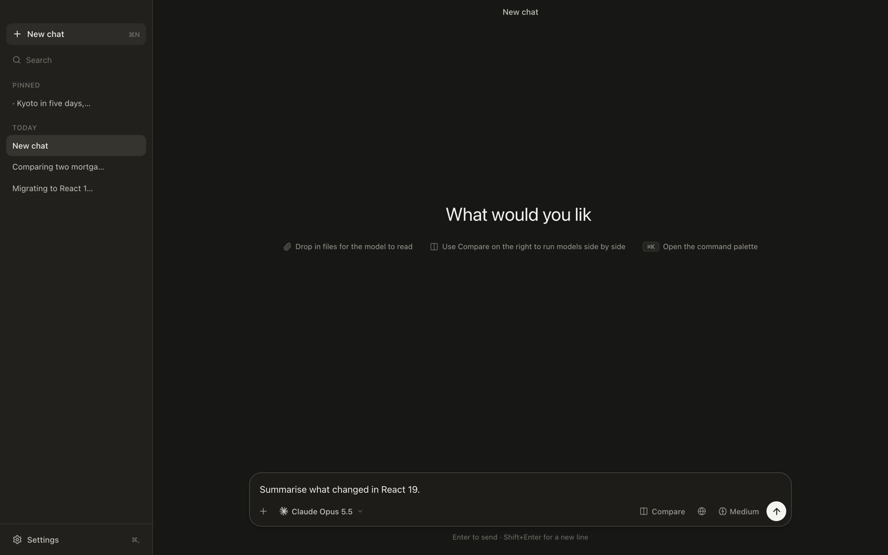
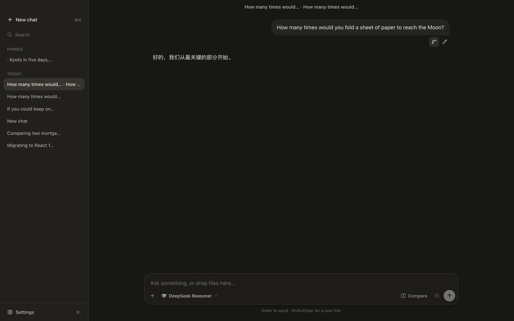
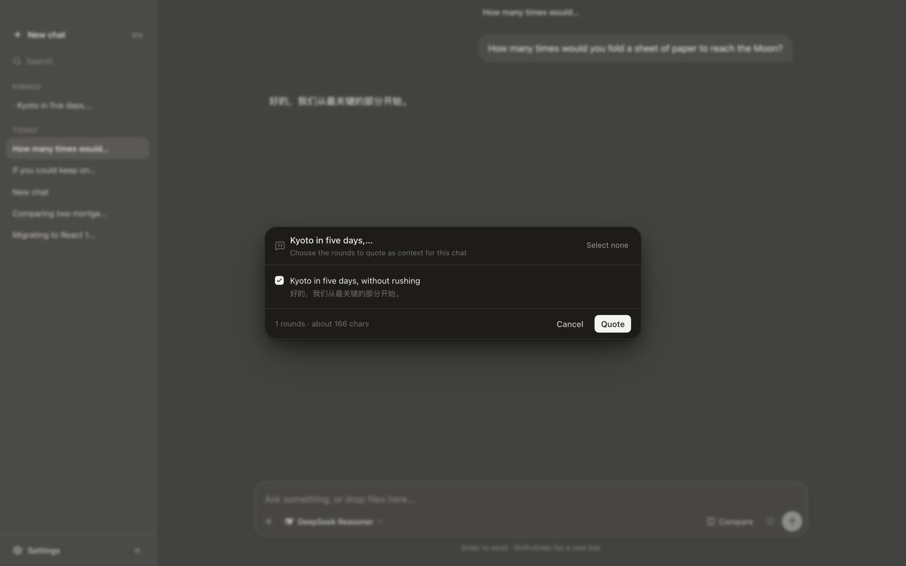

<div align="center">
  
  <h1>HmmChat</h1>
  <p><em>One question, more than one answer, side by side.<br>
  A chat light enough to forget it is not the one that came with your Mac.</em></p>
  <p>
    <a href="https://github.com/lintsinghua/hmmchat/releases"></a>
    
    
    
    
    
  </p>
  <p>
    <a href="README.zh-CN.md">中文</a>
  </p>
</div>

Ask one question. Get more than one answer, side by side, and compare. The
open-source aggregators (LibreChat, Lobe Chat, Open WebUI, Chatbox, Cherry
Studio) solve every problem at once and end up heavy — panels, plugins and
settings for things you never asked for. The vendor apps (claude.ai,
chatgpt.com) are calm, but you only get one vendor.

HmmChat is the narrow middle. **Lightweight, plain, direct:** one window, one
column of navigation, one composer, no second rail and no dashboard. It opens
like an app rather than a web console — and where the other clients make you
choose between calm and comparison, this one compares several models without
giving up the calm.

<table>
<tr>
<td width="50%"></td>
<td width="50%"></td>
</tr>
<tr>
<td><sub><b>One question, several models.</b> Equal columns streaming at their own pace, each stoppable and regenerable on its own.</sub></td>
<td><sub><b>Or just one.</b> The same code path: a single-column chat is a turn with one reply.</sub></td>
</tr>
<tr>
<td></td>
<td></td>
</tr>
<tr>
<td><sub><b>Branch from any question.</b> A side question continues in its own chat, holding everything up to that point.</sub></td>
<td><sub><b>Quote an earlier chat.</b> Tick the rounds to bring in, and quote one model's answers when the source had several.</sub></td>
</tr>
</table>

## Highlights

- **Side-by-side comparison** — several models on one question, up to four.
  Columns stream independently, each stoppable and regenerable on its own; a
  column added mid-conversation shows the answer it inherited and can be asked
  to answer for itself.
- **Narrow it, or read one on its own** — untick columns to follow up with only
  some models (Esc widens it again; a column left out shows *Not asked* and
  never sees that turn as context). A column header's ⤢, or ⌘K → *View … alone*,
  shows one model's chat at single-column width, with the rounds it sat out
  folded into one line.
- **Removing a model loses nothing** — the × on a chip keeps the column's
  answers: *Undo* brings it straight back, and the Compare menu lists it under
  *Removed* with its rounds. Re-adding that model returns the same column.
- **Branch from any question** — cut the chat at a turn and carry on in a new
  one holding every answer up to that point, so a side question never derails
  the thread it came from. Turns keep their branches too: edit a question and
  the original stays, one click away.
- **Quote an earlier chat** — bring a past chat in as context, tick the rounds
  to include, and pick whose answers to quote when the source compared models.
  The quote is a snapshot carried like an attachment, and its chip opens the
  source.
- **Everything else, quietly** — Anthropic, OpenAI, Gemini, OpenRouter and any
  OpenAI-compatible endpoint; the provider's own web search or Tavily / Brave /
  Exa behind one switch; reasoning depths limited to what each model accepts and
  set per column; text, image, PDF and Office attachments, offered only to
  models that can read them; a composer that reopens as your last send left it;
  and every shortcut rebindable by pressing the keys you want.

Deliberately **not** included: plugins, characters, knowledge bases, a
temperature panel, prompt libraries, image generation.

## Quick Start

### Install

Download `HmmChat_x.y.z_aarch64.dmg` from
[**Releases**](https://github.com/lintsinghua/hmmchat/releases), open it and
drag HmmChat into Applications.

The app is not signed with an Apple Developer ID yet, so the first launch is
blocked with "Apple could not verify…". Click **Done**, then open
**System Settings → Privacy & Security** and choose **Open Anyway** at the
bottom. Or, from Terminal:

```bash
xattr -dr com.apple.quarantine /Applications/HmmChat.app
```

Requires macOS 11 or later, on Apple silicon.

### Build from source

Needs Node 20+, Rust, and the Xcode command line tools.

```bash
git clone https://github.com/lintsinghua/hmmchat.git
cd hmmchat
pnpm install
pnpm app              # the desktop app, with hot reload
pnpm app:build        # or: a release .app + .dmg in src-tauri/target/release/bundle/
```

### First run

Open **Settings → Add**, pick a provider, and paste an API key. The key goes
straight into the macOS keychain-backed native store; it is never displayed
again, and it never reaches the webview (see
[Keys never enter the webview](#keys-never-enter-the-webview)).

Nothing else is required: no account, no server, no telemetry. The interface
ships in English and Chinese — **Settings → General → Interface language**.

### Try it without a key

The whole app also runs in a browser against a mock provider — no Tauri build,
no API keys, no cost:

```bash
pnpm mock             # terminal 1: mock provider on :8787
pnpm dev              # terminal 2: the app on :5173
```

Point a provider at `http://127.0.0.1:8787/anthropic/v1` (or `/openai/v1`,
`/openai-responses/v1`, `/google/v1beta`, and `/compatible/v1` for a custom
OpenAI-compatible provider such as DeepSeek) with any non-empty key. The mock
speaks all three wire protocols and emits reasoning and hosted-search events, so
the streaming path is fully exercisable.

Feature flags ride in the model id, e.g. `claude-opus-5-5?slow=1&reason=1`.

Set `MOCK_SCRIPT=path/to/script.json` to make the mock answer from a script
instead: a streaming request whose last user message contains an entry's `match`
gets that entry's reply for the model (or its `*` reply), paced at `cps`
characters per second, with optional reasoning and search sources. Unmatched and
non-streaming requests behave as usual. The schema is described in
`scripts/mock-script.example.json`.

## How it works

```
┌──────────────────────────────────────────────────────────────┐
│ webview (React 19 + Vite + Tailwind v4)                      │
│   composer · thread · sidebar · settings · ⌘K palette         │
│   Vercel AI SDK  ← provider adapters, streaming, tool loop    │
│         │ custom fetch (src/lib/transport.ts)                 │
└─────────┼────────────────────────────────────────────────────┘
          │ Tauri IPC: Channel (streaming) + invoke
┌─────────▼────────────────────────────────────────────────────┐
│ Rust (src-tauri)                                             │
│   http_stream  — reqwest proxy, base64 chunks, cancellation   │
│   secrets      — write-only key store, origin-bound           │
│   tauri-plugin-sql — SQLite                                  │
└──────────────────────────────────────────────────────────────┘
```

Three decisions carry most of the design:

**The AI SDK runs in the webview.** Vendor streaming formats differ enough
(`message_start`/`content_block_delta` vs responses events vs Gemini candidates)
that hand-rolling four parsers is the main source of bugs in projects like this.
The SDK normalizes them, so the app's streaming code is one `switch` on
`fullStream` part types.

**Every request goes through Rust.** Vendor APIs reject browser-originated calls
via CORS. `src/lib/transport.ts` implements a `fetch` that tunnels through a Rust
command, and the SDK's providers accept it as an ordinary `FetchFunction` — so no
provider adapter knows a proxy exists.

<a id="keys-never-enter-the-webview"></a>

**API keys never enter the webview.** The frontend stores a placeholder
(`{{secret:provider:abc}}`) where the key belongs; Rust substitutes the real
value on the way out, and only for the origin the key was saved against. There
is no read path — model output cannot talk a script into exfiltrating a key,
because no function returns one. See `src-tauri/src/secrets.rs`.

## The data model

One question is a **turn**, and a turn has **N replies** — one per lane. A
single-column chat is simply the case where N is 1. Nothing branches on "am I in
compare mode"; the thread renderer reads the lane count and draws either one
column or a grid.

Chats are a tree of turns (editing a question creates a sibling branch); replies
are *versioned siblings* under a turn rather than tree nodes, because
regenerating one model's answer must not fork the whole chat.

Two details carry the compare feature:

`replyFor` (`src/chat/types.ts`) — a lane added mid-conversation has no reply for
the earlier turns, so it inherits the answers of the lane it branched from.
Without that fallback, adding a second model would hand it a chat with no history
and no visible symptom.

`hidden` on a lane — removing a column sets it, rather than dropping the lane.
The answers stay, the lane chain stays intact (so descendants keep resolving to
the same context), and `restoreLane` brings the column back exactly as it was.

## Verifying

```bash
pnpm check            # typecheck + unit tests
pnpm verify:streams   # asserts the SDK's stream parts match what the engine switches on
pnpm verify:ui        # drives the app in Chrome, writes screenshots to shots/
```

`verify:streams` is the one worth understanding. The engine's stream handling is
a switch over part type names (`text-delta`, `reasoning-delta`, `tool-call`, …).
An SDK rename would not throw — it would produce empty answers. That script pins
the contract by running the real adapters against the mock and asserting each
part arrives.

`verify:ui` needs Chrome at the default macOS path (or `CHROME_PATH`), and runs
the app end to end: configure a provider, send a message, compare two models, run
a search, open the palette.

## Layout

```
src/
  i18n/        core (t/useT) · catalog/ (every string, by area)
  lib/         transport (the Tauri fetch) · db (SQLite + in-memory) · secrets · open
  providers/   registry · capabilities · reasoning (the depth mapping) · model discovery
  search/      Tavily / Brave / Exa adapters, exposed as one web_search tool
  chat/        types (the data model) · context · engine · session · smoother · store
  components/  shell · sidebar · thread · composer · settings · palette · message · ui
  styles/      tokens.css · global.css · markdown.css
src-tauri/src/ lib.rs · http.rs · secrets.rs
scripts/       mock-llm.mjs · verify-streams.mjs · shoot.mjs · make-icon.mjs
```

Two things are worth knowing before editing styles:

- **`markdown.css` deliberately does not style `pre`, `table` or `code`.**
  Streamdown owns those elements and marks them `data-streamdown="code-block"`,
  `"table"`, etc. Styling both layers produced a doubly-boxed code block and a
  stray language label.
- **Streaming text does not live in the chat graph.** It lives in a separate map
  keyed by reply id (`src/chat/store.ts`), so a token arriving in one column does
  not re-render the other three.

## Adding a string

`src/i18n/` is the only place user-visible copy lives. An entry is a pair:

```ts
export const thread = {
  skipped: { en: 'Not asked', zh: '未参与' },
} satisfies Record<string, Entry>
```

`t(thread.skipped)` reads it outside React (engine, helpers); `useT()` inside a
component, and re-renders when the language changes. Counted strings use
`counted(entry, n)` with `{ one, many }`, since English needs a singular and
Chinese does not.

## Model capabilities

What a model can do — whether it reasons and at what depths, whether it reads
images or PDFs, whether it can be given documents — comes from a snapshot of
[models.dev](https://models.dev), generated into `src/providers/catalog.data.ts`:

```bash
pnpm sync:catalog          # re-fetch from models.dev
MODELS_DEV_FILE=/path/to/api.json pnpm sync:catalog   # from a local copy
```

It replaced a hand-written table of regexes that was wrong in ways nobody could
see: whole vendors flattened to "no thinking" while their models exposed a
switch, an `xhigh` level the UI could never reach, and every gateway model
treated as unable to reason because its *provider* was unknown. Vendor capability
facts change monthly; this is not something to maintain by hand.

Family rules remain underneath, for ids the catalog has never heard of — a
brand-new model, a self-hosted rename. They reason about generations rather than
pretending to know individual models.

From the same data:

- **Depth control** offers only the levels the model accepts. `gpt-5-pro` reasons
  at one setting, so it gets no control at all; `o3` rejects `none`, so it gets
  no off switch; `gpt-5.1` accepts it, so it does.
- **Value mapping** clamps to the nearest level the model does accept, so a
  requested depth can never be sent as a value the vendor rejects.
- **Attachments** are gated by input type. Images need the model to see them;
  PDFs do not, because their text is extracted on your machine and always
  readable.
- **Hosted search** is offered where the vendor runs one and the model takes tool
  calls: Claude 3.5+, OpenAI gpt-4o/4.1/5+ and the o-series, Gemini 2+. models.dev
  has no search field, so the family is matched by id and the catalog's
  tool-calling flag rules out image and TTS variants. OpenRouter runs its own
  search, so there it covers any model that takes tool calls.

## Keyboard

All of these are rebindable in **Settings → Shortcuts**, where a binding is
recorded by pressing it.

| | |
|---|---|
| `⌘N` | new chat |
| `⌘K` | command palette |
| `⌘P` | switch model |
| `⌘\` | show / hide sidebar |
| `⌘,` | settings |
| `Esc` | stop generating |
| `Enter` | send |
| `⇧Enter` | newline |

Enter handling checks both `isComposing` **and** `keyCode === 229`. On WebKit the
Enter that confirms an IME candidate reports `isComposing: false` while leaving
`keyCode` at 229, so guarding on `isComposing` alone makes a Chinese-language
user send half-typed messages.

## Design notes

- **No accent colour.** The primary action is ink-on-paper in light mode and
  paper-on-ink in dark. A single saturated accent is the fastest way to make a
  utility look like a toy.
- **One column of navigation.** No second rail, no persistent right panel —
  settings are behind one modal. The clutter in comparable apps is mostly
  parallel panels.
- **Motion explains state; it does not decorate.** 120–320ms, exponential-out,
  transform and opacity only. Streaming body text never animates its layout.
- **Four durations and two curves**, in `tokens.css`. Nothing animates for
  longer than 320ms, and `prefers-reduced-motion` collapses all of it.

## License

MIT.
